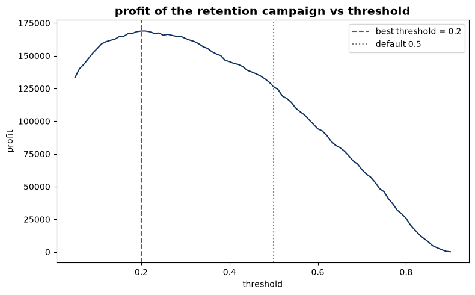
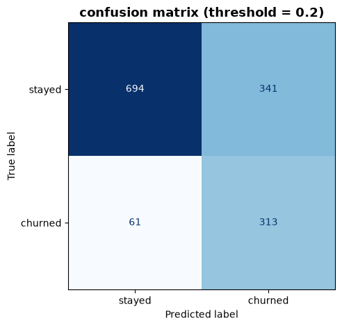
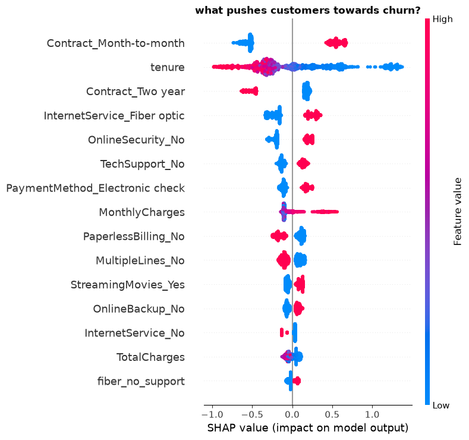
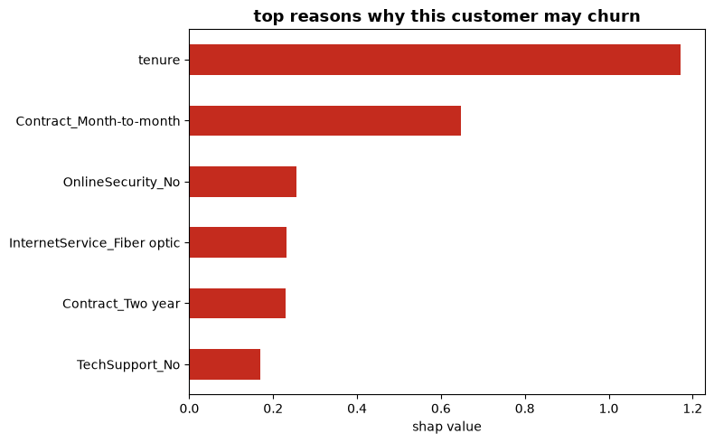

# Telecom Customer Churn Prediction

Predicting which telecom customers will leave, finding out why, and deciding who should get a retention offer.

**Dataset:** [IBM Telco Customer Churn (Kaggle)](https://www.kaggle.com/datasets/blastchar/telco-customer-churn) - 7,043 customers, 26.5% of them churned.
**Tools:** python, pandas, numpy, matplotlib, seaborn, scikit-learn, FLAML (AutoML), LightGBM, SHAP

This is version 2 of my churn project. Version 1 (data cleaning, EDA, Logistic Regression and Random Forest) is in my first repo: [Telecom-Churn-Prediction](https://github.com/RaginiGupta21/Telecom-Churn-Prediction).

---

## What I did and why

**1. Cleaned the data and kept all customers.**
11 customers had a blank `TotalCharges`. They are new customers (tenure = 0) who were not billed yet, so I set their total to 0 instead of deleting them.

**2. Added 3 new features.**
- `num_addons` - how many extra services the customer has
- `auto_pay` - 1 if the customer pays by automatic bank transfer or credit card
- `fiber_no_support` - 1 if the customer has fiber optic internet but no tech support

**3. Split the data properly.**
I split into train and test first and fitted the scaler only on the training data, so nothing from the test set leaks into training (in v1 I scaled before splitting). I used `stratify=y` so both parts have the same churn rate.

**4. Used AutoML (FLAML).**
FLAML tries different models (LightGBM, XGBoost, Random Forest, Extra Trees) and settings automatically for 60 seconds. It checks every option with 5-fold cross-validation, which means the training data is split into 5 parts and each part is used once for checking. It picked [LightGBM / your model].

**5. Chose the threshold using business cost.**
A model gives each customer a churn probability. By default we say "will churn" at 0.5 or more, but 0.5 is not special. Sending an offer costs money and saving a customer earns money, so I tested thresholds from 0.05 to 0.90 and picked the one with the highest profit. The threshold was chosen using training data only.

The money values are my assumptions, not real company data:
- one retention offer costs 50
- a saved customer is worth about 777 (12 months of the average monthly charge)
- 30% of offers actually save the customer

**6. Explained the model with SHAP.**
SHAP shows how much each feature pushed a prediction towards churn or towards staying, for the whole dataset and for a single customer.

**7. Saved the model** in the `models` folder so a web app can use it.

## Results

Test set = 1,409 customers that were not used for training.

| Model | Accuracy | Recall | Precision | ROC-AUC |
|---|---|---|---|---|
| Logistic Regression | 80.41% | 55.88 % | 65.31 % | 0.8409 |
| Random Forest | 79.99 % | 51.87 % | 65.54 % | 0.837 |
| FLAML AutoML (lgbm) | 79.99 % | 53.21 % | 65.03 % | 0.8473 |

All three models are very close, with accuracy between 79.99% and 80.41%. FLAML (LightGBM) has the best ROC-AUC (0.8473), but it is only about 0.006 better than Logistic Regression, and Logistic Regression is actually slightly better on accuracy and recall at the default threshold.

### The threshold made the biggest difference

| Strategy | Customers contacted | Churners caught | Profit |
|---|---|---|---|
| Contact nobody | 0 | 0% | 0 |
| Contact everybody | 1409 | 100% | 16,729 |
| Model with threshold 0.5 | 306 | 53% | 31,087 |
| Model with threshold 0.2 | 654 | 84% | 40,260 |

With the lower threshold the model catches 84% of the churners instead of 53%. The cost is that overall accuracy drops from about 80% to 71%, and more customers get an offer who would have stayed (654 customers contacted instead of 306). This is fine here because an offer is cheap compared to losing a customer.




## What makes customers churn?

Looking at the SHAP chart (the most important features are at the top):

- **Contract type is the strongest signal.** Month-to-month customers are much more likely to churn, and two-year contract customers are much less likely to. This matches what I found in the v1 EDA.
- **Tenure matters a lot.** Customers who joined recently are at high risk, and customers who have stayed for a long time rarely leave.
- **Fiber optic internet, no online security and no tech support** all push customers towards churn.
- **Paying by electronic check and having a high monthly charge** also increase the risk.
- One of my own new features, `fiber_no_support`, appears in the top 15 but has only a small effect. The other two (`num_addons` and `auto_pay`) did not make the top 15, so they added little.

In short, the riskiest customer is a new customer on a month-to-month contract with fiber optic internet, no online security or tech support, and a high monthly bill.



Top reason's behind churning 



## Folder structure

```
Telecom-Churn-Prediction-AutoML/
├── data/
│   └── WA_Fn-UseC_-Telco-Customer-Churn.csv
├── models/
│   ├── churn_model.pkl
│   ├── model_columns.pkl
│   └── threshold.pkl
├── images/
├── Telecom_Churn_AutoML.ipynb
├── requirements.txt
├── .gitignore
└── README.md
```

## How to run

```
git clone https://github.com/RaginiGupta21/Telecom-Churn-Prediction-AutoML.git
cd Telecom-Churn-Prediction-AutoML
pip install -r requirements.txt
```
Open `Telecom_Churn_AutoML.ipynb` and run all cells. FLAML searches for a fixed time (60 seconds), so the numbers can change a little between runs.

## Limitations

- The profit numbers use assumed costs, they are not from a real company.
- I used one dataset with no dates, so I could not test on future customers.
- The probabilities from the model are not calibrated, so a prediction of 0.7 does not guarantee exactly 70%.
- SHAP shows what the model uses, it does not prove why a customer really left.

## Author

Ragini Gupta - BSc Data Science, SDBI, Mumbai